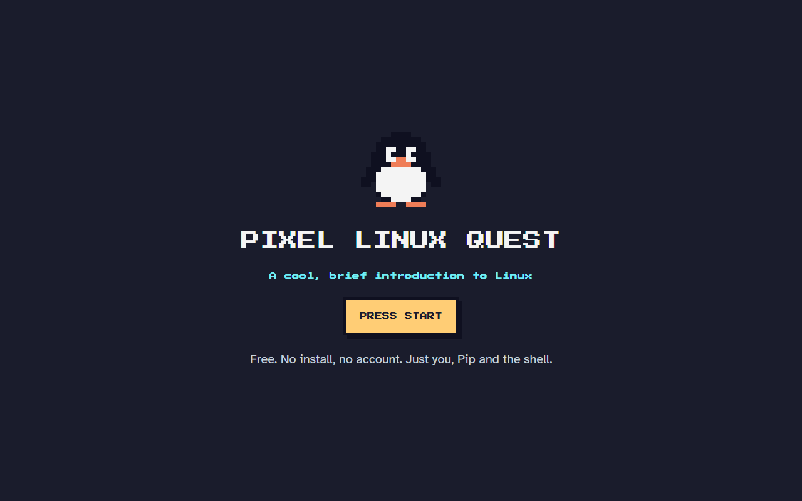
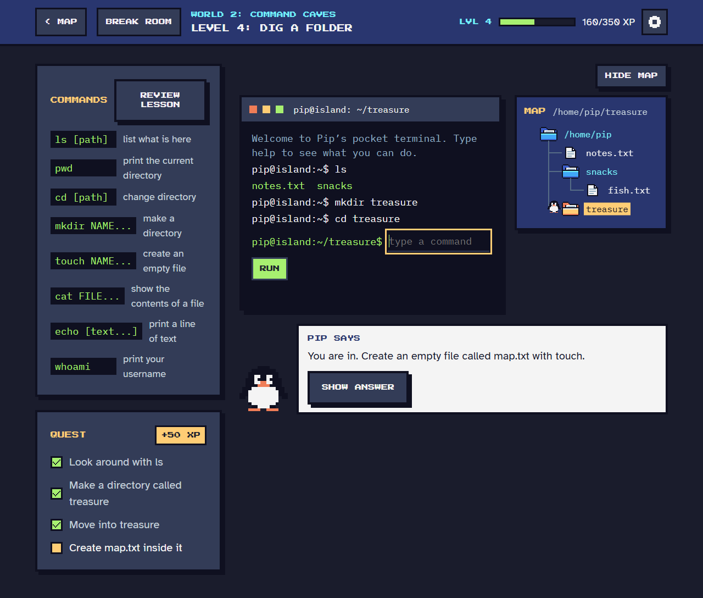
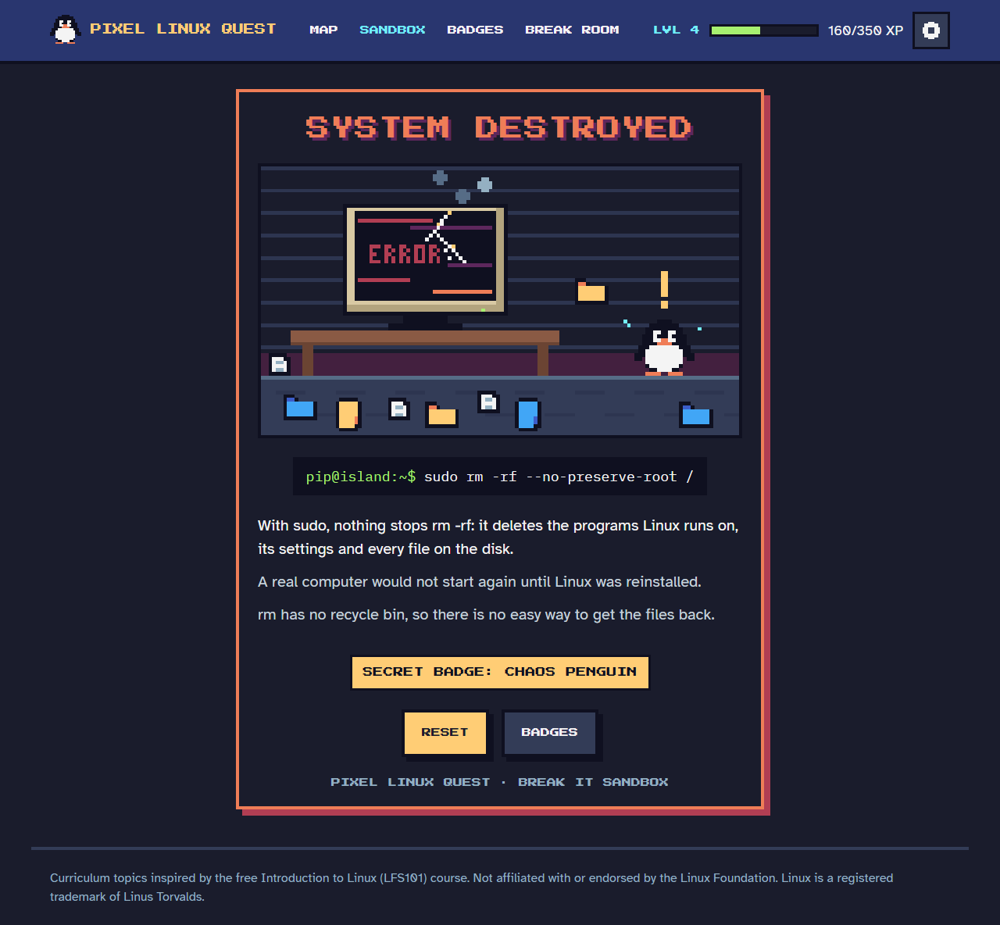
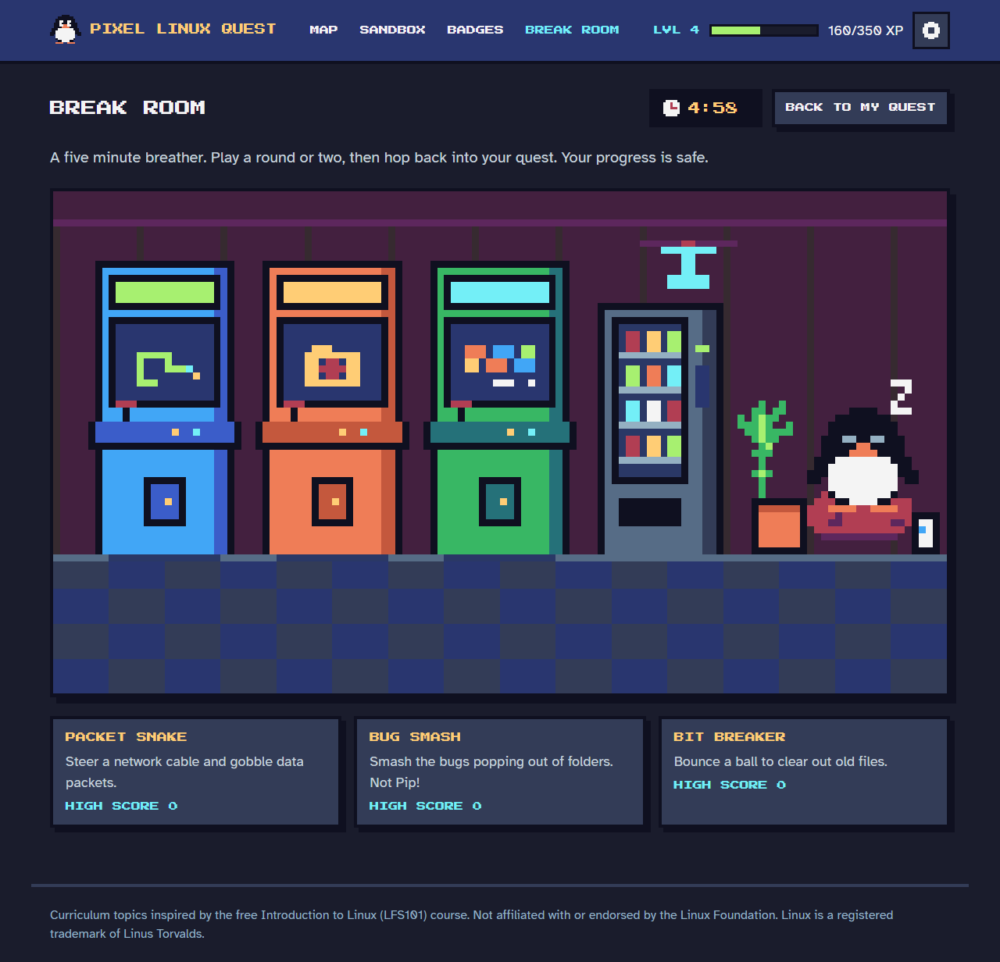

# Pixel Linux Quest

A free retro pixel game that gives you a cool, brief introduction to Linux, right in your browser.

Read a few short lessons with Pip the penguin, then prove what you learned by completing quests in a pretend "pocket terminal". No install, no account, nothing to break on your real computer.

**Play it: https://pixel-linux-quest.vercel.app**



## Screenshots

| A level with the live folder map | The Break It sandbox, after `rm -rf` |
| --- | --- |
|  |  |



## Features

- **Short lessons, then a test.** Each level is 2 to 4 tiny lesson pages, then a terminal challenge or a quiz.
- **A pretend terminal in the browser.** A small Linux-like shell written in TypeScript, with a virtual filesystem, real-looking error messages, quotes, `*` patterns, Tab completion, Ctrl+C and Ctrl+L, and command history.
- **Pip explains mistakes.** When a command fails you still see the real error, and Pip adds a short, friendly explanation without giving the answer away.
- **Live folder map.** A pixel map of the folders sits next to the terminal, with Pip standing wherever you are.
- **World map, XP and badges.** Worlds unlock in order. Progress is saved in your browser.
- **Intro story.** A short pixel art cutscene about how Unix, GNU and Linux came to be.
- **Break It sandbox.** Every command, a realistic pretend system and no rules. Try `rm -rf /` and see what happens (and find the secret badge).
- **Break Room.** A tiny pixel arcade for a five minute break: Packet Snake, Bug Smash and Bit Breaker. Every game over screen has a true Linux tip.
- **Accessible.** Real buttons and links, keyboard play, readable fonts, visible focus, works on phones and respects reduced motion.

## Run it locally

You need [Node.js](https://nodejs.org/) (the version in `.nvmrc`).

```sh
git clone https://github.com/Maame-codes/pixel-linux-quest.git
cd pixel-linux-quest
npm install
npm run dev        # start the dev server
npm run test       # run the unit tests
npm run build      # type check and build to dist/
```

## Tech stack

- [Vite](https://vite.dev/), [React](https://react.dev/) and TypeScript, with react-router
- Plain CSS with custom properties for the design tokens (no UI library)
- [Vitest](https://vitest.dev/) and Testing Library for tests
- Pixel art drawn in code (`src/game/pixelArt/`), Break Room games on HTML canvas
- Static site on [Vercel](https://vercel.com/). No backend: progress lives in `localStorage`

## Contributing

Ideas, bug reports, lesson corrections, new levels and new Break Room games are all welcome. Start with [CONTRIBUTING.md](CONTRIBUTING.md), and please follow the [Code of Conduct](CODE_OF_CONDUCT.md).

Spotted a wrong Linux fact? Open a **Lesson correction** issue. Accuracy matters a lot here.

## Licences

This project uses three licences, depending on what kind of thing it is.

| What | Licence | File |
| --- | --- | --- |
| The code | MIT | [LICENSE](LICENSE) |
| Lesson text, quizzes, the intro story, Pip's tips and the pixel art | CC BY-NC 4.0 | [LICENSE-CONTENT](LICENSE-CONTENT) |
| The fonts | SIL Open Font Licence 1.1 | next to each font in `src/assets/fonts/` |

**Code (MIT).** You can use, copy, change and sell the code, as long as you keep the copyright notice.

**Content and art (CC BY-NC 4.0).** You may share and adapt the content with credit ("Pixel Linux Quest by Maame", with a link), but not sell it or use it commercially. This covers:

- `src/content/` (lessons, quizzes, objectives and hints, the intro story, the sandbox's pretend files)
- `src/arcade/tips.ts` (Pip's tips)
- `src/game/pixelArt/scenes/`, `src/game/pixelArt/sprites.ts`, `src/game/pixelArt/props.ts`, `src/game/pixelArt/font.ts` (the pixel art)
- `src/components/Pip.tsx` (Pip's sprite)
- `design-reference/`, `docs/screenshots/` and the images in `public/` (link preview and favicons)

Program code inside those files, such as objective checks, may also be used under MIT.

**Fonts (OFL).** The fonts keep their own SIL Open Font Licences, which allow free use and redistribution.

## Credits

- Curriculum topics inspired by the free Introduction to Linux (LFS101) course. Not affiliated with or endorsed by the Linux Foundation. Linux is a registered trademark of Linus Torvalds.
- Fonts, all under the [SIL Open Font Licence 1.1](https://openfontlicense.org/):
  - [Press Start 2P](https://fonts.google.com/specimen/Press+Start+2P) by CodeMan38 ([licence](src/assets/fonts/OFL-press-start-2p.txt))
  - [Atkinson Hyperlegible](https://fonts.google.com/specimen/Atkinson+Hyperlegible) by the Braille Institute of America ([licence](src/assets/fonts/OFL-atkinson-hyperlegible.txt))
  - [IBM Plex Mono](https://fonts.google.com/specimen/IBM+Plex+Mono) by IBM ([licence](src/assets/fonts/OFL-ibm-plex-mono.txt))
- Colours from the Sweetie 16 palette by GrafxKid.
- Built with [Claude Code](https://claude.com/claude-code).

Made by [Maame](https://github.com/Maame-codes).
